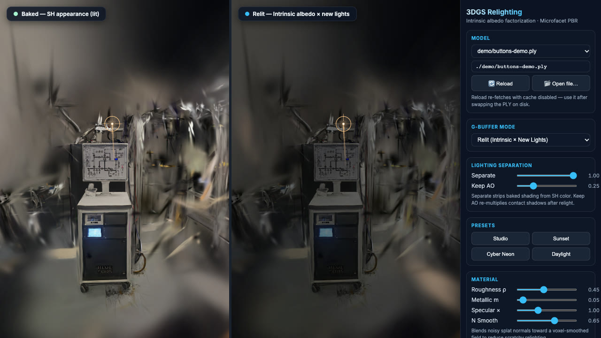

# Relighting

Interactive relighting of 3D Gaussian Splatting scenes from a single baked
`.ply`. A standard 3DGS file stores baked radiance (albedo x lighting) in its
SH DC terms, so the tool first splits that into a smooth irradiance field and
an intrinsic albedo (Retinex-style), estimates per-splat normals from each
Gaussian's shortest axis, and re-shades the scene with new lights using a
Cook-Torrance/GGX BRDF.

**Status: experimental.** The WebGL viewer works and is used by hand. The CPU
reference renderer draws the same geometry from the same camera: a browser
test checks that the two agree within a stated tolerance on the baked and normals
views (mean difference under 1 and 99th percentile under 4, out of 255, on the
test scenes; see [ROADMAP.md](ROADMAP.md) for what is still missing).

## Live demo

**[Open the live demo](https://television05.github.io/Relighting/)**: the viewer running in your
browser, with nothing to install. (It goes live once this branch is merged to `main`: the
`Pages` workflow publishes the site on every push to `main`.)

[](docs/media/hero.mp4)

*The 12 second clip (click the picture): baked appearance on the left, the relit result on the
right. The camera orbits, a warm sun is swept across the scene, then the view switches to
intrinsic albedo, baked irradiance and surface normals.*

### How it works

- A standard 3DGS `.ply` stores baked radiance (albedo x lighting) in its SH DC terms. The viewer
  reads it in a worker and shows it unchanged in the left pane.
- A Retinex-style split separates a smooth irradiance field from an intrinsic albedo, so the
  old lighting can be removed.
- Each Gaussian's shortest axis gives its surface normal; the normals are smoothed over neighbours.
- A coarse density volume built from the splats is ray-marched for shadows.
- The right pane re-shades the albedo with up to 8 lights (Cook-Torrance/GGX), drawn as depth-sorted
  alpha-blended splats in WebGL2.

### The demo scene and its limits

The demo opens `demo/buttons-demo.ply`: a lab scene (a mobile equipment cart in a room), 196,410
splats, 11.0 MB, made by [`tools/slim_ply.py`](tools/slim_ply.py) from the 249,973-splat, 41 MB
`Buttons.ply`. The tool drops the stored normals and the higher-order spherical-harmonic terms
(the viewer shades from the DC term, so nothing visible changes), removes a box
around a person who walked into the capture (6,522 splats, `--crop`, below), ranks the rest by
`opacity x (two largest scales)` and keeps the best that fit an 11 MB budget (21% of the splats are
removed in all, the faintest and smallest first). Against the full scene, rendered headless on the GPU from the default view, the mean absolute
pixel difference is 0.0005 (baked pane) and 0.009 (relit pane) on a 0 to 1 scale, and the two are
indistinguishable by eye: [`docs/media/demo-vs-full.jpg`](docs/media/demo-vs-full.jpg) (left full
scene, right demo scene; top baked, bottom relit). The relit pane differs a little more because
the lighting split and the shadow volume are computed from whichever splats are present. The
only places that differ visibly are where the removed person stood.

Regenerate it with `git lfs pull`, then
`python tools/slim_ply.py Buttons.ply demo/buttons-demo.ply --target-mb 11 --crop=-5.8,-3.0,-1.5,1.5,-2.8,1.0`.
The box is in the scene file's own coordinates (`xmin,xmax,ymin,ymax,zmin,zmax`, the export frame
before the viewer's Y/Z flip); splats whose centre is inside are dropped before the ranking.

Limits: it needs a browser with WebGL2 (a recent Chrome, Edge, Firefox or Safari) and runs entirely
on your device. A 3DGS capture of a room has floaters and blurry background splats; the relit
result is a plausible re-shading, not a physically exact one, and the lights cast shadows only
through a coarse volume. "Open file..." lets you view a 3DGS `.ply` of your own, which never leaves your
computer; the file picker, not the hosted copy, is the way to try your own scenes. The other sample
scene, `father-day.ply`, is not published (see Licence). To build the same site locally:
`python demo/assemble_site.py _site`, then serve `_site` with any static file server.

Performance (measured 2026-11-13 with `tests/viewer/timing_probe.py`, headless Chromium on Metal,
Apple M2 Max, window 1300x720 so each pane is about 500x720, machine busy with other jobs): the demo scene
loads in about 0.5 s and draws both panes in about 20 ms (the viewer's own frame interval was
19 ms), about 50 frames a second, so no quality setting was needed. On software GL
(SwiftShader), which has no GPU, it is far slower; that is what the CI browser tests use.

## Layout

- `index.html` + `src/`: the WebGL2 viewer (main UI). Split view: left pane
  is the baked SH appearance (reference), right pane is the relit result. Up
  to 8 lights (directional / point / spot, `MAX_LIGHTS = 8`) with ray-marched
  shadows through a per-model density volume, four presets (studio, sunset,
  cyber, day), material sliders, `Separate` / `Keep AO` / `N Smooth`, six
  G-buffer modes (relit, intrinsic albedo, baked SH DC, baked irradiance/AO,
  surface normals, specular only) and a model picker. Loads
  `demo/buttons-demo.ply` by default; `?ply=father-day.ply` or `?ply=Buttons.ply` picks another.
  `index.html` is only the page; the code is native ES modules in `src/`
  with no build step, so the folder can be hosted as static files:

  | module | what it does |
  |---|---|
  | `app.js` | entry point: panes, controls, loading, render loop |
  | `load-worker.js`, `scene-loader.js`, `fetch-scene.js` | download and preprocess a scene in a module worker (main-thread fallback), progress |
  | `pipeline.js`, `stages.js` | parse → normals → lighting split → pack, and the progress stages |
  | `ply.js`, `frame.js` | PLY header and decode; export-frame flip and quaternion remap |
  | `intrinsics.js`, `normals.js`, `occupancy.js`, `pack.js` | Retinex split, plane-fit normals, shadow volume, GPU packing |
  | `renderer.js`, `gizmos.js`, `gl.js`, `shaders/` | WebGL2 panes, light markers, GLSL |
  | `sort.js`, `sort-worker.js` | per-frame depth sort in a worker |
  | `ui.js`, `lights.js`, `presets.js`, `camera.js`, `model-picker.js` | sidebar, light rig, orbit camera |
  | `errors.js`, `status.js` | plain-language error messages, status line, progress bar |
  | `test-hook.js` | `?test=1` handle for the browser tests |

  Everything except the page modules (`app.js`, `ui.js`, `renderer.js`, ...)
  is pure (no DOM, no GL) and unit-tested under Node.
- `serve.py`: stdlib-only static server for the viewer, with a `/models`
  endpoint and no-cache headers. Opens a browser on start.
- `static_server.py`: the file policy both servers share (see Servers below).
- `render_splats.py`: command line of the CPU reference renderer. Writes
  `rendered_neutral.png` and `rendered_relit.png`, or with `--serve` starts
  `render_server.py`, which serves `GET /render` (plus `/models` and
  `/reload`, which drops the parsed-PLY cache). Query validation lives in
  `render_params.py`.
- `cpu_render/`: the CPU renderer itself, in NumPy. Same world frame,
  quaternion order (`rot_0 = w`), orbit camera and focal length as the viewer;
  each splat's full 3D covariance (all three scales) is projected with the
  perspective Jacobian (EWA splatting) and composited front to back in 16 px
  tiles. Modes: `relit`, `neutral` (baked), `albedo`, `normals`. It is not at
  feature parity with the viewer's lighting: one directional + one point light,
  no shadows, no normal smoothing.
- `Relighting 3D Gaussian Splatting.md`: design notes and implementation
  status.
- `Buttons.ply`, `father-day.ply`: sample scenes, stored in Git LFS.
- `demo/`: the demo scene (`buttons-demo.ply`, a slimmed derivative of `Buttons.ply`, plain Git not LFS), its `NOTICE`, and `assemble_site.py`, which builds the folder that the `Pages` workflow publishes.
- `tools/`: `slim_ply.py` (makes the demo scene) and `record_hero.py` (records the clip in `docs/media/`).
- `tests/`: Python tests (`tests/*.py`), browser tests of the viewer
  (`tests/viewer/`) and Node unit tests of the viewer's pure modules
  (`tests/js/`).

## Install

```bash
git lfs install && git lfs pull                     # sample scenes (~158 MB)
python3 -m venv .venv && .venv/bin/pip install -r requirements.txt
```

The viewer (`serve.py` + `index.html`) needs only Python 3 (stdlib) and a
WebGL2 browser with ES modules in workers (current Chrome, Edge, Firefox,
Safari).

When a load fails, the viewer says what happened and what to do in plain
language (file not found, not a 3DGS PLY, a Git LFS placeholder that was never
pulled, no WebGL2, out of memory, graphics set-up failure); the raw error is in
the browser console. Scene requests carry a cache-busting `?_=` query string
only when the page is served from this computer (`localhost`, `127.x`); Reload
always asks for a fresh copy. The venv is only for `render_splats.py` (numpy, pillow) and
the tests, which need **Python 3.10+** (`render_splats.py` uses a `X | None`
annotation at module level); verified on 3.12, 3.13 and 3.14.5 on 2026-09-25.

## Configure

Nothing to configure: no environment variables, no config file. Drop any
`*.ply` into the repo root and it appears in the model picker.

## Run

```bash
python3 serve.py                 # http://127.0.0.1:8000/index.html
python3 serve.py 8080            # pick a port
python3 serve.py --no-browser    # do not open a browser window
```

CPU reference renderer:

```bash
.venv/bin/python render_splats.py            # writes rendered_*.png from father-day.ply, 1600x1600
.venv/bin/python render_splats.py --ply Buttons.ply --width 800 --height 600 --yaw 0.4 --pitch 0.25 --zoom 10
.venv/bin/python render_splats.py --serve    # viewer + GET /render?mode=relit&w=512&h=512
```

The camera is the viewer's orbit camera: `--yaw`, `--pitch` and `--zoom` (and
`yaw`, `pitch`, `zoom` on `/render`) mean the same as the viewer's
`?cam=yaw,pitch,zoom`, and default to the view the viewer opens with.
`Buttons.ply` at 800x600 takes about 1.7 s per image (measured 2026-11-13 on an
Apple M2 Max at a load average of about 7: 1.7 s and 1.6 s on two runs; earlier runs
at a load average of 18 to 200 took 1.8 s up to about 7 s). 1600x1600 took about 10 to
13 s on the loaded machine and was not re-measured. The old per-pixel renderer took 25 to 110 s at 800x600. `/render` always renders `father-day.ply` (`PLY_PATH`).

### Servers: what they expose

Both servers listen on `127.0.0.1` (this computer only). To let another device
connect, pass `--host 0.0.0.0`; the server then prints a warning, because
anyone who can reach your machine can open the viewer and download the scenes.

They serve an explicit allow-list, nothing else: `index.html`, the `*.ply`
files in the repo root, and files with web suffixes (`.js`, `.css`, images,
...) inside the `src/`, `assets/` and `demo/` folders. Dotfiles, `.git`, source and
notes, `..` paths, symlinks that leave the repo and directory listings all
answer "not found". If you add a new folder of viewer files, add its name to
`PUBLIC_DIRS` in `static_server.py`.

`GET /render` checks every setting (`mode`, `w`, `h`, `stride`, light and
material values, camera) against a range. A bad value gets a `400` whose JSON `error`
text says which setting is wrong and what is allowed, for example `Image width
(w) must be a whole number between 16 and 2048`. At most two renders run at
once; extra requests get a `503` asking to try again.

## Test

```bash
.venv/bin/pip install -r requirements-dev.txt
.venv/bin/python -m pytest -q
```

The tests build small synthetic splat PLYs, so they do not need the LFS
models. They cover PLY parsing and the derived normals/albedo, the lighting
separation, the CPU renderer (normals against analytic fixtures, the projected
covariance against sampled points, the tile compositor against a plain
back-to-front blend, all four modes), both HTTP servers (the file allow-list,
loopback binding, `/render` validation and limits), and the WebGL viewer,
including a CPU-against-viewer parity test (`tests/viewer/test_cpu_parity.py`).

### Viewer (browser) tests

`tests/viewer/` drives the real `index.html` in headless Chromium (no window
opens). It writes three scenes with known geometry (`tests/viewer/splat_scenes.py`:
a tilted plane, a sphere, a ground plane under a floating ball) in the same PLY
layout as `Buttons.ply`, then checks, with numeric tolerances rather than golden
images: no console or shader errors, nothing blank, every G-buffer mode distinct,
the scene the right way up, rendered normals within a few degrees of the known
ones (this catches a wrong quaternion order or a lost Y/Z flip), a new light
changing only the relit pane, the bright side following the light, and a shadow
behind an occluder.

```bash
.venv/bin/python -m playwright install chromium     # once
.venv/bin/python -m pytest -q -m browser            # software GL (SwiftShader)
RELIGHTING_GL=gpu .venv/bin/python -m pytest -q -m browser   # on the GPU, much faster
RELIGHTING_SUBPATH=/Relighting .venv/bin/python -m pytest -q -m browser   # against the Pages site, served under /Relighting/
.venv/bin/python -m pytest -q -m "not browser"      # everything except the browser tests
```

When a browser test fails, the images it captured are saved in
`test-results/viewer/`. The tests talk to the viewer through two URL
parameters: `?cam=yaw,pitch,zoom` sets the starting camera (also handy for
sharing a view), and `?test=1` exposes `window.__relightTest` (read back the
panes, pause the render loop). Neither changes anything when absent.

Timing probe (prints, never fails): load, preprocess, main-thread blocking
and frame times on the synthetic scenes and on any real scene you pass.
Measured 2026-11-13 on Metal (Apple M2 Max), headless Chromium: loading
`Buttons.ply` blocked the main thread for 393-465 ms before parsing moved into
a worker and 65-103 ms after (one long task, the GPU upload).

```bash
.venv/bin/python tests/viewer/timing_probe.py --ply Buttons.ply   # --gl auto|gpu|software
```

## Lint and format

```bash
.venv/bin/pre-commit install     # once per clone: runs the checks below on every commit
npm ci                           # eslint + prettier
.venv/bin/ruff check . && .venv/bin/ruff format --check .
npx eslint . && npx prettier --check .
```

Viewer unit tests (Node 22+, no browser or GPU):

```bash
npm test                         # node --test "tests/js/*.test.js"
```

The same checks run in CI (`.github/workflows/ci.yml`). eslint also enforces
the size limits on `src/`: no file over 500 lines, no function over 75.

## Licence

The code is released under the [MIT licence](LICENSE), copyright 2026 Tarun
Vadapalli. **The sample scenes (`Buttons.ply`, `father-day.ply` and anything
derived from them, including `demo/buttons-demo.ply`) are not covered by that licence.** They are
included only so the viewer has something to show (the owner has confirmed the derived demo scene may be published, for viewing, in the live
demo); do not reuse or redistribute them without checking with the owner.

## Roadmap

See [ROADMAP.md](ROADMAP.md) for current state, known bugs, milestones and
open questions.
